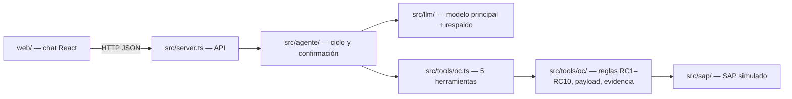

# Agente de Órdenes de Compra SAP — Reto 03 · Periferia IT Group

[](https://github.com/JSBeltran93/reto-03-beltran/actions/workflows/ci.yml)

Agente conversacional que lee el paquete de una solicitud de compra, lo valida contra los maestros y los controles **RC1–RC10** y crea la orden de compra en un **SAP simulado** solo cuando corresponde, pidiendo confirmación humana en las excepciones.

**Link público:** https://reto-03-beltran-production.up.railway.app — no requiere clave de acceso.

## Inicio rápido

Requisitos: Node.js 22 (`.nvmrc`) y npm. La clave del modelo solo se necesita para el chat.

```bash
npm install          # instala la raíz y el workspace web/; configura los hooks de git
cp .env.example .env # completar ANTHROPIC_API_KEY para usar el chat
npm run dev          # back (http://localhost:3000) + front (http://localhost:5173)
```

### Variables de entorno

| Variable                 | Por defecto         | Uso                                                                        |
| ------------------------ | ------------------- | -------------------------------------------------------------------------- |
| `ANTHROPIC_API_KEY`      | —                   | Clave del modelo; solo en el backend (`.env` local o Variables de Railway) |
| `LLM_MODELO`             | `claude-opus-5-5`   | Modelo principal                                                           |
| `LLM_MODELO_RESPALDO`    | `claude-sonnet-5-5` | Modelo de respaldo si el principal falla                                   |
| `LLM_TIMEOUT_MS`         | `60000`             | Tiempo máximo por llamada al modelo (el SDK reintenta 1 vez)               |
| `MAX_ITERACIONES`        | `25`                | Tope de iteraciones herramienta → modelo por turno (CA1)                   |
| `MAX_SEGUNDOS_TURNO`     | `240`               | Duración máxima de un turno (el front espera hasta 270 s)                  |
| `MAX_SOLICITUDES_MINUTO` | `20`                | Límite de mensajes por minuto e IP (responde 429 con `Retry-After`)        |
| `MAX_TOKENS_SESION`      | `200000`            | Tope de tokens por sesión                                                  |
| `MAX_TOKENS_DIA`         | `3000000`           | Tope diario de tokens del servidor                                         |
| `MAX_SESIONES`           | `200`               | Sesiones en memoria (se desaloja la de uso menos reciente)                 |
| `PORT`                   | `3000`              | Puerto HTTP (Railway lo asigna)                                            |

`.env.example` es la referencia completa.

## Demo sin modelo

```bash
npm install && npm run demo
```

Procesa los 6 casos de `fixtures/reto-03/solicitudes/` llamando directamente a las herramientas, sin clave:

| Caso    | Resultado                                                                         |
| ------- | --------------------------------------------------------------------------------- |
| sol-001 | OC `4500000001`; la segunda ejecución devuelve el mismo número (idempotencia)     |
| sol-002 | Bloqueada por RC1 (proveedor inexistente) con acción sugerida                     |
| sol-003 | Bloqueada por RC2 y RC3 (aprobador sin autoridad); sugiere revisar CC-3030        |
| sol-004 | Confirmación RC5 (25.000.000 vs 26.500.000, 6 %); tras confirmar, OC `4500000002` |
| sol-005 | Confirmación RC8 (retroactiva); tras confirmar, OC `4500000003`                   |
| sol-006 | Pendiente de confirmar el IVA derivado C1 (condiciones Z030 derivadas)            |

Genera en `out/`: `control.csv`, `sap/ordenes.jsonl`, `<caso>/trazabilidad.json`, `<caso>/aprobacion.txt` y `aprobacion.pdf`.

## Calidad

| Comando                       | Qué hace                                                                    |
| ----------------------------- | --------------------------------------------------------------------------- |
| `npm test`                    | Tests del back (Vitest, supertest, LLM falso) y del front (Testing Library) |
| `npm run typecheck`           | TypeScript estricto en back y front                                         |
| `npm run lint`                | ESLint con tipos, React Hooks y accesibilidad                               |
| `npm run check`               | Formato, lint, tipos y tests en orden                                       |
| `npm run build` / `npm start` | Compila el front y arranca el servidor de producción (lee `.env` si existe) |

Hooks de git: lint y formato al commitear, mensaje validado con commitlint, tipos y tests antes del push. El CI repite todo, más la demo, el build y `npm audit`.

## API

| Método | Ruta                | Cuerpo                                      | Respuesta                                                                                                                        |
| ------ | ------------------- | ------------------------------------------- | -------------------------------------------------------------------------------------------------------------------------------- |
| `POST` | `/api/chat`         | `{ "sessionId": "<uuid>", "message": "…" }` | `{ "reply", "toolCalls": [{ "nombre", "args", "ok", "resumen", "datos"? }], "needsConfirmation", "casoPendiente"?, "esError"? }` |
| `GET`  | `/api/sessions/:id` | —                                           | `{ "id", "historial": [...], "needsConfirmation", "casoPendiente" }`; 404 si no existe                                           |
| `GET`  | `/api/health`       | —                                           | `{ "ok": true, "provider", "model" }` (sin claves)                                                                               |

Ejemplo de `resumen`: `"apta · bloqueos: ninguna · confirmaciones: RC5"`. Las rutas viven en `RUTAS_API` (`src/comun/rutas-api.ts`), compartidas por back y front. `sessionId` debe ser un UUID y `message` tener entre 1 y 4000 caracteres. Cuerpo inválido o JSON roto → `400`; cuerpo de más de 32 kb → `413`; ruta `/api/*` inexistente → `404`; más de `MAX_SOLICITUDES_MINUTO` mensajes por minuto e IP → `429` con cabecera `Retry-After`; error inesperado → `500` con un mensaje genérico (sin trazas). Los errores del modelo o de una herramienta llegan como `reply` con `esError: true` y la sesión sigue activa.

## Arquitectura



## Estructura

```
agent/prompt.md                   comportamiento del agente (system prompt)
src/
├── server.ts                     API HTTP (crearAplicacion) y raíz de composición
├── configuracion.ts              variables de entorno validadas con zod
├── agente/                       ciclo, compuerta de confirmación, sesiones, bitácora
├── llm/                          puerto AdaptadorLlm, Anthropic y respaldo
├── tools/oc.ts · tools/oc/       las 5 herramientas oc_* y el dominio
├── sap/                          puerto SapAdapter y SAP simulado
├── comun/                        resultado, errores, reloj, registrador, contratos y rutas
└── knowledge/ordenes-compra.md   conocimiento del proceso
web/                              chat: React 19, Vite, Tailwind, TanStack Query, axios
pruebas/                          tests del back (los del front van junto a cada componente)
documentacion/decisiones/         decisiones de arquitectura (ADR)
fixtures/reto-03/                 insumos del reto (solo lectura)
modulo/                           bonus: agente empaquetado para otras plataformas
demo.ts                           verificación sin modelo
```

## Documentación

- [`SOLUCION.md`](SOLUCION.md): planteamiento de la solución (12 secciones del PRD), incluido el uso de IA.
- [`documentacion/decisiones/`](documentacion/decisiones): ADR 0001–0007.
- [`CONTRIBUTING.md`](CONTRIBUTING.md): guía de desarrollo, ramas, commits y estándares.

## Despliegue

Railway con configuración como código (`railway.json`): build por defecto de Railpack (instala dependencias y ejecuta `npm run build`), arranque `npm start`, health check en `/api/health`. Un push a `develop` despliega; alternativa equivalente: `railway up`. La clave se configura solo en Variables de Railway. El disco es efímero: `out/` se pierde al redesplegar ([ADR-0007](documentacion/decisiones/0007-despliegue-en-railway.md)).

## Bonus: módulo reutilizable (`modulo/`)

- `modulo/agent.md`: frontmatter (`description`, `mode: primary`, `permission: {edit: deny, bash: deny}`) y el contenido de `agent/prompt.md`.
- `modulo/tools/oc.ts`: re-exporta solo las 5 herramientas de `src/tools/oc.ts` (las mismas, no una copia).
- `modulo/skill/ordenes-compra/SKILL.md`: frontmatter (`name`, `description`) y el contenido de `src/knowledge/ordenes-compra.md`.

`pruebas/modulo.test.ts` falla si alguna copia diverge de su fuente.

## Entrega

La rama de trabajo y despliegue es `develop`. Al entregar se integra en `main` mediante un PR `develop → main`, así que cualquiera de las dos ramas contiene la versión final.
