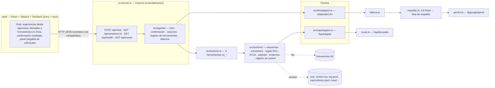
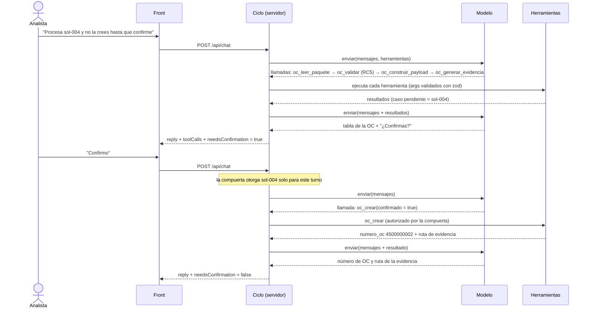

# SOLUCIÓN — Reto 03 "Órdenes de Compra SAP"

| Campo          | Valor                                                                                                                                                    |
| -------------- | -------------------------------------------------------------------------------------------------------------------------------------------------------- |
| **Estado**     | Implementado                                                                                                                                             |
| **Versión**    | 1.0                                                                                                                                                      |
| **Fecha**      | 2026-11-15                                                                                                                                               |
| **Alcance**    | Agente conversacional de punta a punta: chat, ciclo del agente, cinco herramientas P0 del PRD más `oc_leer_excel` (P1), SAP simulado, despliegue público |
| **Enlaces**    | Link público: https://reto-03-beltran-production.up.railway.app · Repositorio: este repo (rama `develop`)                                                |
| **Documentos** | [`README.md`](README.md) (operación) · [`CONTRIBUTING.md`](CONTRIBUTING.md) (desarrollo)                                                                 |

## Resumen

- El agente lee el paquete de una solicitud de compra (correo, solicitud, cotización, aprobación, factura), aplica los controles **RC1–RC10** contra los maestros, muestra la OC como quedaría en SAP y la crea en un **SAP simulado** solo cuando corresponde.
- Las decisiones de negocio son **deterministas y viven en código**; el modelo orquesta herramientas, explica y pregunta. Por eso `demo.ts` y más de 350 tests (más de 250 del back y más de 100 del front) corren sin clave.
- La confirmación humana (CA3) la **exige el ciclo**, no solo el prompt: el modelo no puede confirmar por el usuario ni alterar el payload validado.
- El front (React + TanStack Query) es **chat primero**: conversación centrada con el compositor abajo, sugerencias clicables desde `GET /api/casos` en el estado vacío, cada llamada a herramienta visible en línea con sus argumentos y su resultado resumido, y la confirmación resaltada con los dos valores. La lista de solicitudes es un panel plegable.
- Si el modelo principal falla, un **modelo de respaldo** atiende el turno; si ambos fallan, el usuario recibe un error claro y la sesión sigue viva.

## Objetivos

| Objetivo del PRD                               | Cómo se cumple                                                                         |
| ---------------------------------------------- | -------------------------------------------------------------------------------------- |
| **O1** Eliminar la digitación (sol-001)        | sol-001 termina en OC `4500000001` sin intervención                                    |
| **O2** Bloquear lo que no cumple (sol-002/003) | Bloqueos RC1 y RC2/RC3 con razón y acción sugerida construida desde los maestros       |
| **O3** Dudas → confirmaciones (sol-004/006)    | RC5 y RC6 piden confirmación con ambos valores antes de crear                          |
| **O4** Medir el desvío (sol-005)               | RC8 marca `retroactiva = true` en `out/control.csv`; la OC solo se crea tras confirmar |

## No objetivos

- Conexión real a SAP (se diseña en §6), lectura de PDF binarios (los `.xlsx` sí se leen con `oc_leer_excel`, P1, pero el flujo usa la solicitud normalizada en JSON), recepción de mercancía, factura o pago.
- Autenticación, roles, multiusuario y base de datos (PRD §3.2): sesiones en memoria y archivos en `out/`.
- Workflow de aprobación: el agente **verifica** la aprobación existente, no la solicita.

## Contexto

Cada compra llega a administración con tres piezas que la analista digita a mano en SAP; la validación de quién puede aprobar qué monto es mental y muchas OC se crean después de la factura. El reto pide automatizar la preparación de la OC con un agente que nunca resuelva una excepción a la fuerza.

---

## 1. Problema en una frase

La analista administrativa digita a mano cada OC en SAP y valida de memoria quién puede aprobar qué monto, lo que le cuesta tiempo y errores a ella, deja sin control sistemático a **contabilidad/auditoría** y le impide a la **dirección** medir cuántas OC se crean después de la factura.

## 2. Arquitectura

Capas con **puertos y adaptadores** alrededor de un dominio puro. El proveedor del modelo vive detrás del puerto `AdaptadorLlm`: `src/llm/gemini.ts` (Google Gemini), `src/llm/respaldo.ts` (modelo principal → respaldo) y `src/llm/fabrica.ts`, que los compone a partir de la configuración.

| Pieza                                 | Dónde vive                                                                                                                                                                     |
| ------------------------------------- | ------------------------------------------------------------------------------------------------------------------------------------------------------------------------------ |
| **Comportamiento** (system prompt)    | `agent/prompt.md`                                                                                                                                                              |
| **Conocimiento** del proceso          | `src/knowledge/ordenes-compra.md`                                                                                                                                              |
| **Ejecución** (herramientas y reglas) | `src/tools/oc.ts` + `src/tools/oc/`                                                                                                                                            |
| Raíz de composición                   | `src/server.ts` compone las dependencias reales del servidor; `src/tools/oc.ts` expone una instancia por defecto (SAP simulado + reloj del sistema) para `demo.ts` y `modulo/` |

Reglas de dependencia: el dominio no importa Express, el SDK de Gemini ni el ciclo; solo `src/llm/gemini.ts` importa `@google/genai`; el SAP y el reloj se inyectan con una fábrica de herramientas, así tests y demo son deterministas.

## 3. Ciclo del agente

`src/agente/ciclo.ts` (`ejecutarTurno`), bucle manual de tool use:

1. Toma el **candado de la sesión**: los turnos de una misma sesión se ejecutan en orden; un doble clic o un reintento nunca intercala mensajes ni rompe el par llamada/resultado de herramienta.
2. Registra el mensaje del usuario y actualiza la **compuerta de confirmación**: solo una confirmación corta y completa ("confirmo", "sí, procede"…) otorga el caso pendiente más reciente, y solo para ese turno. Mensajes con reservas ("ok, pero…", "no", "todavía", "antes", "primero") no confirman. Si hay varios casos pendientes, se confirma el más reciente y la tarjeta del front muestra cuál es (`casoPendiente`).
3. Envía la conversación al puerto LLM (`enviar`) con las 6 herramientas en JSON Schema, derivado de los mismos esquemas zod.
4. Revisa el motivo de fin: una respuesta truncada por límite de tokens no ejecuta llamadas; un rechazo del modelo se informa con un mensaje explícito.
5. Por cada llamada: la compuerta autoriza, el registro **valida los argumentos con zod** (si fallan, el error vuelve al modelo), se ejecuta la herramienta y se registra en `out/log.jsonl` y en el historial. Cualquier excepción se devuelve como `ERROR_INTERNO`, siempre con un resultado por llamada.
6. Repite hasta la respuesta final, el tope de iteraciones o el plazo máximo del turno.

| Regla                      | Implementación                                                                                                                                                                                                                                                                                                                                                                                                             |
| -------------------------- | -------------------------------------------------------------------------------------------------------------------------------------------------------------------------------------------------------------------------------------------------------------------------------------------------------------------------------------------------------------------------------------------------------------------------- |
| CA1 tope de iteraciones    | `MAX_ITERACIONES` (25). Al alcanzarlo, una última llamada con la opción `sinLlamadas` del puerto (en Gemini: las mismas herramientas con `functionCallingConfig.mode = NONE`) pide resumir lo hecho y lo pendiente. Además, `MAX_SEGUNDOS_TURNO` limita la duración total del turno.                                                                                                                                       |
| CA2 sin valores inventados | El prompt lo prohíbe y el diseño lo hace innecesario: `oc_validar`, `oc_construir_payload` y `oc_crear` recalculan todo desde los documentos (ver §5, "Los argumentos del modelo no son fuente de datos").                                                                                                                                                                                                                 |
| CA3 confirmación humana    | El modelo no puede confirmar por el usuario: si llama `oc_crear` con `confirmado: true` sin que el usuario haya confirmado ese caso en su último mensaje, el servidor lo ejecuta con `confirmado: false` y responde `REQUIERE_CONFIRMACION` (o crea la OC si el caso no tiene confirmaciones). Un caso queda pendiente solo si `oc_validar` devuelve confirmaciones; `needsConfirmation` sale de ese estado, no del texto. |
| CA4 trazabilidad           | Cada llamada aparece en línea en el chat (etiqueta humana, nombre técnico, argumentos compactos y resultado resumido) y en `out/log.jsonl`.                                                                                                                                                                                                                                                                                |
| CA5 errores claros         | Timeouts, límites, clave inválida (`LLM_CLAVE_INVALIDA`) y solicitudes rechazadas (`LLM_SOLICITUD_INVALIDA`) se traducen a español y se registran con status y tipo (sin secretos); la respuesta lleva `esError: true`.                                                                                                                                                                                                    |
| Costo                      | Topes de tokens por sesión (`MAX_TOKENS_SESION`) y por día (`MAX_TOKENS_DIA`), límite de solicitudes por IP (`MAX_SOLICITUDES_MINUTO`, 429 con `Retry-After`) y sesiones desalojadas por uso reciente (LRU).                                                                                                                                                                                                               |

## 4. Elección del modelo

- **Proveedor y modelo:** Google Gemini (único proveedor), `gemini-3.6-flash` como principal (`LLM_MODELO`) y como respaldo, en orden, `gemini-3.5-flash-lite`, `gemini-3.1-flash-lite` y `gemini-3-flash-preview` (`LLM_MODELO_RESPALDO`, lista separada por comas: el plan gratuito limita el cupo diario por modelo), con el SDK `@google/genai`, llamadas a funciones en modo `AUTO` y ciclo manual en el servidor. Latencia: las decisiones de negocio son deterministas en las herramientas y el modelo solo orquesta, así que el razonamiento va en `thinkingLevel` bajo (`LLM_RAZONAMIENTO`, por defecto `bajo`; Gemini 3 Flash razona en alto si no se fija), con `maxOutputTokens` de 8 192 y la temperatura en 1, la que Google recomienda para Gemini 3.
- **Por qué:**
  - La clave es gratuita y se obtiene al instante en Google AI Studio (https://aistudio.google.com/apikey): cualquiera puede levantar el proyecto sin cuenta de pago.
  - Buen uso de herramientas (_function calling_) con esquemas JSON derivados de zod, que es lo único que el agente necesita del modelo.
  - Ventana de contexto amplia: el historial completo de un caso (paquete, validación, payload, trazabilidad) cabe sin recortes.
  - Las decisiones de negocio son deterministas y viven en las herramientas (RC1–RC10, payload, idempotencia); el modelo solo orquesta, explica y pregunta, así que no se necesita el modelo más caro del mercado y Flash sirve de respaldo digno.
- **Costo estimado por caso procesado:** ~5–6 llamadas al modelo, ~40 K tokens de entrada acumulados (el historial se reenvía en cada llamada) y ~3 K de salida. Con los precios de lista de pago de la Gemini API (prompts ≤ 200 K tokens; el plan gratuito no cobra, pero tiene límites de solicitudes por minuto y por día):

| Modelo                             | Entrada                     | Salida                      | Total por caso | 40 OC al mes |
| ---------------------------------- | --------------------------- | --------------------------- | -------------- | ------------ |
| `gemini-3.6-flash` (principal)     | 40 000 × 1,50 / 1 M = 0,060 | 3 000 × 7,50 / 1 M = 0,0225 | **≈ USD 0,08** | ≈ USD 3,30   |
| `gemini-3.5-flash-lite` (respaldo) | 40 000 × 0,30 / 1 M = 0,012 | 3 000 × 2,50 / 1 M = 0,0075 | **≈ USD 0,02** | ≈ USD 0,78   |

Precios de lista del plan de pago de la Gemini API, en USD por millón de tokens (noviembre de 2026): 3.6 Flash 1,50 entrada / 7,50 salida; 3.5 Flash-Lite 0,30 entrada / 2,50 salida. Los tokens de razonamiento se facturan como salida, así que los 3 K de salida son un piso: con el doble de salida, el principal queda en ≈ USD 0,10 por caso. Con la clave gratuita de AI Studio no hay cobro, pero sí límites de solicitudes; los modelos Pro (`gemini-3.1-pro-preview`) no tienen cuota gratuita y `gemini-2.5-*` ya no se ofrece a cuentas nuevas, por eso se eligió Flash. No se usa caché explícita de contexto.

- **Cambio de modelo o de proveedor:** el modelo se cambia con `LLM_MODELO` / `LLM_MODELO_RESPALDO`. El proveedor queda aislado detrás del puerto `AdaptadorLlm` (PRD §6.1): cambiarlo es escribir otro adaptador en `src/llm/` y componerlo en `src/llm/fabrica.ts`, sin tocar el ciclo, las herramientas ni el front. La elección vigente se lee en `GET /api/health` (`provider: "gemini"`, `model`).

### Respaldo del modelo

El PRD no lo exige; se agregó porque un link público no debe depender de un solo modelo. Principal y respaldos son del mismo proveedor (3.6 Flash → 3.5 Flash-Lite → 3.1 Flash-Lite → 3 Flash Preview).

| Situación del modelo principal                               | Comportamiento                                                                                                                                                                                                                                                                                                                                                                                                                             |
| ------------------------------------------------------------ | ------------------------------------------------------------------------------------------------------------------------------------------------------------------------------------------------------------------------------------------------------------------------------------------------------------------------------------------------------------------------------------------------------------------------------------------ |
| Timeout, límite de solicitudes (429), no disponible, rechazo | `AdaptadorConRespaldo` reintenta el mismo turno con cada modelo de `LLM_MODELO_RESPALDO` en orden (`gemini-3.5-flash-lite`, `gemini-3.1-flash-lite`, `gemini-3-flash-preview`); el turno de un respaldo se reenvía con la firma de razonamiento ficticia que Gemini 3 admite para historiales de otro modelo; un fin por seguridad o contenido bloqueado (`SAFETY`, `PROHIBITED_CONTENT`…) se traduce a `LLM_RECHAZO` y activa el respaldo |
| Clave inválida o solicitud inválida                          | No se usa el respaldo (fallaría igual); error claro con su código                                                                                                                                                                                                                                                                                                                                                                          |
| Principal y respaldo fallan                                  | Error claro con `esError: true`; la sesión sigue viva                                                                                                                                                                                                                                                                                                                                                                                      |
| Sin modelo en absoluto                                       | Las herramientas deterministas siguen disponibles: `npm run demo` procesa los 6 casos                                                                                                                                                                                                                                                                                                                                                      |

El respaldo es otro adaptador del mismo puerto: el ciclo no cambia. Al pasar al respaldo se descarta el contenido propio del principal (firmas de razonamiento) y el turno se reconstruye con texto y llamadas.

## 5. Matriz de controles

Cada regla es un objeto `{id, tipo, evaluar}` en `REGLAS` (`src/tools/oc/reglas.ts`); agregar una regla no toca el motor.

| Regla | Tipo                    | Implementación                                                                                                                                                       | Casos                                        |
| ----- | ----------------------- | -------------------------------------------------------------------------------------------------------------------------------------------------------------------- | -------------------------------------------- |
| RC1   | Bloqueo                 | Busca por NIT normalizado; sin NIT, por nombre normalizado (sin tildes, puntuación ni sufijo societario). Ambigüedad o inactivo también bloquean.                    | sol-002 bloquea; sol-006 resuelve por nombre |
| RC2   | Bloqueo                 | Aprobación presente, con "Aprobado" como palabra (no negada en la misma oración: "No tengo objeciones. Aprobado." sí aprueba) y enviada por un aprobador del centro. | sol-003                                      |
| RC3   | Bloqueo                 | `valor_total ≤ tope` del aprobador **en ese centro**; sugiere quién sí cubre el monto o escalar.                                                                     | sol-003                                      |
| RC4   | Bloqueo                 | Subárea dentro del centro; centro inexistente también bloquea.                                                                                                       | Prueba sintética                             |
| RC5   | Confirmación            | Diferencia relativa > 2 % o sin cotización; reporta **ambos valores** y el porcentaje.                                                                               | sol-004 (6 %)                                |
| RC6   | Confirmación + derivado | Sin IVA → `indicador_iva_default` del proveedor. Un código informado que no existe en el maestro también pide confirmación.                                          | sol-006 → C1                                 |
| RC7   | Derivado                | Sin condiciones de pago → las del proveedor; solo informa. Un código informado que no existe en el maestro pide confirmación.                                        | sol-006 → Z030                               |
| RC8   | Confirmación            | Factura anterior a la solicitud → `retroactiva = true` y marca en `out/control.csv`.                                                                                 | sol-005                                      |
| RC9   | Confirmación            | Aprobación anterior a la solicitud (por día calendario).                                                                                                             | Prueba sintética                             |
| RC10  | Bloqueo                 | `abs(cantidad × valor_unitario − valor_total) > 1` bloquea.                                                                                                          | Prueba sintética                             |

Resultado sobre los fixtures (verificado por `demo.ts` y `pruebas/matriz-resultados.test.ts`):

| Caso    | Objetivo | Resultado                                                                                                                                                                                                            |
| ------- | -------- | -------------------------------------------------------------------------------------------------------------------------------------------------------------------------------------------------------------------- |
| sol-001 | O1       | OC `4500000001` sin intervención; la segunda ejecución devuelve el mismo número (idempotente)                                                                                                                        |
| sol-002 | O2       | Sin OC (RC1) → "Solicitar la creación del proveedor en SAP…"                                                                                                                                                         |
| sol-003 | O2       | Sin OC (RC2, RC3) → "fvargas@periferia-ficticia.com aprueba en CC-3030 Comercial (tope 80.000.000)…; para CC-2020 aprueba rtorres@periferia-ficticia.com (tope 30.000.000)". Ningún aprobador de CC-2020 cubre 74 M. |
| sol-004 | O3       | Pide confirmación (26.500.000 vs 25.000.000, 6 %); tras confirmar, OC `4500000002`                                                                                                                                   |
| sol-005 | O4       | Pide confirmación (retroactiva); tras confirmar, OC `4500000003` con `retroactiva=true` en control                                                                                                                   |
| sol-006 | O3       | Pide confirmación del IVA derivado C1; condiciones Z030 derivadas                                                                                                                                                    |

`out/control.csv` recibe una fila por intento (HU-5): cada llamada a `oc_crear` agrega su resultado (`creada`, `idempotente`, `bloqueada` o `pendiente`) con la marca `retroactiva`, y `oc_validar` registra el intento `bloqueada` de los casos con bloqueos, que nunca llegan a `oc_crear` porque no hay payload que enviar. Validar un caso apto o construir el payload no escribe en el control. La trazabilidad usa el vocabulario del PRD (`solicitud`, `cotizacion`, `maestro.<nombre>`, `derivado`) y cubre todos los campos; si falta la evidencia, `oc_crear` la genera antes de crear la OC.

**Los argumentos del modelo no son fuente de datos.** `oc_validar` y `oc_construir_payload` reciben `paquete` y `derivados` porque el contrato del PRD §6.2 lo fija, pero releen el caso desde disco y validan y construyen con esos documentos; si el `paquete` recibido difiere o viene incompleto, `oc_validar` y `oc_construir_payload` lo informan en `aviso`. Por eso esos argumentos son tolerantes: todos los campos de `paquete` son opcionales y `derivados` puede omitirse (el modelo real a veces omite adjuntos `null` como `factura`, y un `ARGS_INVALIDOS` solo gastaba iteraciones); un campo con tipo incorrecto sigue rechazándose. `oc_crear` vuelve a reconstruir el payload desde los documentos y compara su huella canónica (`src/comun/huella.ts`) con la del `payload` recibido: si no coinciden, ignora el recibido, crea la OC con el reconstruido y lo informa en `aviso`. Así el modelo no puede alterar un dato (CA2), lo que mitiga el riesgo del PRD §10 de que "el modelo arregle un monto".

**La más difícil:** RC2/RC3. No basta con decir "no autorizado": la regla cruza el maestro para decir dónde sí aprueba esa persona y quién cubre el monto. En sol-003 eso revela que probablemente el centro de costo está mal (la aprobación menciona "preventa").

## 6. Diseño del adaptador SAP real

**Opciones según la viabilidad:**

| Opción                                                      | Cuándo                       | Por qué                                                                    |
| ----------------------------------------------------------- | ---------------------------- | -------------------------------------------------------------------------- |
| **OData `API_PURCHASEORDER_PROCESS_SRV`** (deep insert)     | S/4HANA disponible           | REST documentado, CSRF token, validaciones estándar                        |
| **`BAPI_PO_CREATE1` vía SAP Integration Suite** (o RFC)     | ECC                          | El agente nunca habla RFC; Integration Suite lo expone como REST           |
| **Plan B: archivo de carga masiva y "OC lista para pegar"** | La conexión no es viable aún | Se conserva validación, trazabilidad y control; solo cambia el último paso |

**Recomendación:** empezar con el Plan B y migrar a OData `API_PURCHASEORDER_PROCESS_SRV` cuando se confirme S/4HANA. El Plan B entrega valor desde el primer día sin depender de una integración cuya viabilidad no está confirmada, y la migración no toca el agente: solo cambia el adaptador.

**Plan B en detalle:**

- **Archivo de carga masiva (CSV/LSMW)**, una fila por posición: `solicitud_id`, `sociedad`, `organizacion_compras`, `proveedor_codigo_sap`, `moneda`, `condiciones_pago`, `posicion`, `descripcion`, `cantidad`, `unidad`, `precio_neto`, `indicador_iva`, `centro_costo`, `subarea`, `aprobador`, `evidencia_sha256`. Las OC del día se cargan en un solo paso.
- **"OC lista para pegar" para `ME21N`**: los valores campo por campo en el orden de la transacción (cabecera: proveedor, organización de compras, sociedad, condiciones de pago; posición: texto breve, cantidad, unidad, precio neto, indicador de IVA, imputación al centro de costo) más la ruta de la evidencia a adjuntar.
- **Ahorro:** la validación de RC1–RC10, el payload, la trazabilidad y la evidencia ya están listos; la analista solo transcribe valores verificados o carga el archivo, en lugar de reunir y revisar los documentos de cada solicitud.

La interfaz `SapAdapter` no cambia: se agrega `src/sap/odata.ts` (o `bapi.ts`) y se compone en `src/server.ts`.

**Mapeo del payload (OData):**

| Payload (PRD §7.4)                  | API_PURCHASEORDER_PROCESS_SRV                                                                                                                        |
| ----------------------------------- | ---------------------------------------------------------------------------------------------------------------------------------------------------- |
| `sociedad` / `organizacion_compras` | `CompanyCode` / `PurchasingOrganization`                                                                                                             |
| `proveedor.codigo_sap`              | `Supplier`                                                                                                                                           |
| `moneda`                            | `DocumentCurrency`                                                                                                                                   |
| `condiciones_pago`                  | `PaymentTerms`                                                                                                                                       |
| `posiciones[].numero`               | `PurchaseOrderItem` (10, 20…)                                                                                                                        |
| `posiciones[].descripcion`          | `PurchaseOrderItemText` (40 caracteres; el texto completo va en el texto largo)                                                                      |
| `cantidad` / `unidad`               | `OrderQuantity` / `PurchaseOrderQuantityUnit`                                                                                                        |
| `precio_unitario`                   | `NetPriceAmount` — **convertido a neto**: la solicitud trae valores con IVA y con `TaxCode` C1 SAP lo sumaría de nuevo; `neto = precio / (1 + tasa)` |
| `indicador_iva`                     | `TaxCode`                                                                                                                                            |
| `centro_costo` / `subarea`          | `to_AccountAssignment.CostCenter` / campo de imputación acordado con contabilidad                                                                    |
| `referencia.solicitud_id`           | Campo de referencia (p. ej. `PurchaseOrderNote` o un campo Z) para idempotencia                                                                      |
| `aprobador.evidencia_sha256` + PDF  | Adjunto vía _Attachment Service_ (GOS)                                                                                                               |

**Autenticación y credenciales:** usuario técnico con mínimo privilegio (crear OC en la sociedad 1000), OAuth 2.0 client credentials o certificado X.509 vía Integration Suite. Las credenciales viven en el gestor de secretos del hosting, **nunca** en el agente, el prompt, el repositorio ni los logs.

**Idempotencia y errores parciales:**

- Antes de crear, `buscarOrdenPorReferencia(solicitud_id)`; si existe, devuelve el número. En el simulador esa búsqueda ocurre dentro de la cola de escritura: dos confirmaciones simultáneas no generan dos OC y la segunda responde `idempotente: true`.
- Reintentos con espera creciente solo para errores transitorios (timeouts, 5xx), siempre precedidos de la búsqueda por referencia.
- Si SAP crea la cabecera pero falla una posición o el adjunto, la OC quedaría en un estado nuevo `pendiente_conciliacion` (a agregar con el adaptador real), se reintenta solo el paso faltante y se avisa a la analista; nunca se crea una segunda OC.

## 7. Lectura del proceso: las OC retroactivas

Una OC creada después de la factura deja de ser un control preventivo y se vuelve un registro _a posteriori_: el gasto ya ocurrió sin validar proveedor, tope ni cotización. En sol-005 la factura es del 10 de agosto y la solicitud del 27: la compra se hizo antes de pedirla. Además, en ese caso **la solicitante parece ser la misma analista que crea la OC** (el correo dice "Hola Camila" y lo envía Camila Ortiz), lo que rompe la segregación de funciones. En sol-004 el líder aprobó "por 25 millones" frente a una cotización de 26,5 millones: si se paga lo cotizado, el exceso no está aprobado.

**Qué le diría a la dirección:**

1. **Medir antes de decidir:** `out/control.csv` registra cada llamada a `oc_crear` con `retroactiva`; el indicador debe contar `solicitud_id` distintos, no filas. Indicador mensual: % de OC retroactivas y monto asociado, por centro de costo y solicitante.
2. **Política "sin OC no hay pago"**, con una vía de excepción explícita: una OC retroactiva requiere aprobación de un nivel superior y queda marcada.
3. **Segregación de funciones:** quien solicita no crea su propia OC; el agente puede detectarlo comparando solicitante y analista.
4. **Aprobación por monto exacto:** la aprobación debe cubrir el valor a pagar (cotización), no solo el estimado.

## 8. Decisiones y trade-offs

| Decisión                                                                                                                | Alternativa descartada                                   | Por qué                                                                                                                                       |
| ----------------------------------------------------------------------------------------------------------------------- | -------------------------------------------------------- | --------------------------------------------------------------------------------------------------------------------------------------------- |
| Puertos y adaptadores con dominio puro (`AdaptadorLlm`, `SapAdapter`; SAP y reloj inyectados con `crearHerramientasOc`) | Todo en `server.ts`                                      | Probar reglas y ciclo sin HTTP ni clave; cambiar proveedor o SAP sin tocar el ciclo                                                           |
| Confirmación aplicada en el ciclo (`src/agente/confirmacion.ts`)                                                        | Solo instrucción en el prompt                            | Verificable y resistente a errores del modelo o inyección en los documentos; la herramienta conserva su contrato y `demo.ts` la llama directo |
| Revalidación desde los documentos y huella del payload (se crea siempre con el validado)                                | Confiar en `paquete`, `derivados` y `payload` del modelo | Mitiga el riesgo del PRD §10 sin cambiar el contrato; cuesta releer el caso en cada herramienta                                               |
| Google Gemini como único proveedor (`gemini-3.6-flash` y una lista ordenada de respaldos)                               | Otros proveedores; varios proveedores a la vez           | Clave gratuita en AI Studio, buen _function calling_ y contexto amplio; un solo SDK y una sola clave que gestionar                            |
| Bucle manual de llamadas a herramientas                                                                                 | Ciclo automático de llamadas del SDK                     | El PRD evalúa el ciclo; control explícito de CA1–CA5                                                                                          |
| Node 22 + Express 5 + React 19 + Tailwind; npm workspaces                                                               | Bun; HTML plano                                          | Hosting estándar, testabilidad (`crearAplicacion` con supertest), componentes accesibles; un solo `npm install` y un solo `npm run dev`       |
| TanStack Query + axios en el front                                                                                      | `fetch` con un reducer propio                            | Carga, error, reintento y caché declarativos; cliente HTTP con interceptores                                                                  |
| Chat primero, con sugerencias desde `GET /api/casos`                                                                    | Bandeja de casos como vista principal                    | El PRD §6.1 pide un front de chat que muestre cada llamada con sus argumentos; la lista de solicitudes queda como panel plegable              |
| Modelo de respaldo como adaptador del puerto (`AdaptadorConRespaldo`)                                                   | Un solo modelo                                           | El link sigue respondiendo ante caídas, 429, timeouts o rechazos del principal                                                                |
| Despliegue en Railway con configuración como código (`railway.json`)                                                    | Despliegue manual                                        | Build, arranque y health check versionados; un push a `develop` despliega; el disco es efímero                                                |
| Candado por sesión                                                                                                      | Responder 409 si la sesión está ocupada                  | No se pierde el mensaje ni se rompe el par llamada/resultado de herramienta                                                                   |
| `sessionId` UUID y rutas compartidas (`RUTAS_API`)                                                                      | Texto libre y rutas repetidas                            | Ids no adivinables y un solo lugar para las rutas                                                                                             |
| Español en todo el código salvo los nombres que fija el PRD; constantes centralizadas                                   | Identificadores en inglés; literales repetidos           | Alineación literal con el PRD; sin _magic strings_ ni _magic numbers_                                                                         |
| TypeScript 6 y ESLint 9                                                                                                 | TypeScript 7 / ESLint 10 / oxlint                        | `typescript-eslint` y `jsx-a11y` aún no los soportan                                                                                          |
| tsx en producción; sesiones en memoria                                                                                  | Compilar el backend; base de datos                       | Sin paso de build (lo cubre el health check); la base de datos es no-objetivo del PRD                                                         |

**Dependencias:** `express` (HTTP), `zod` (contratos, obligatorio), `@google/genai` (SDK oficial de Gemini: _function calling_, timeout por solicitud y errores tipados `ApiError`; solo lo importa `src/llm/gemini.ts`), `pdf-lib` (evidencia PDF, P1), `read-excel-file` (`oc_leer_excel`, P1: solo lectura de `.xlsx`, mantenida y liviana; se descartó `xlsx` de npm por sus vulnerabilidades conocidas sin parche en el registro y `exceljs` por su peso y porque también escribe), `tsx` (ejecutar TypeScript), `react` + `react-dom` + `@tanstack/react-query` + `axios` + `react-markdown` + `remark-gfm` (front), `tailwindcss` + `@tailwindcss/vite` (estilos); en desarrollo: TypeScript, Vite + `@vitejs/plugin-react`, Vitest + `@vitest/coverage-v8`, Testing Library + `user-event` + `jest-dom` + `jsdom`, supertest, ESLint (typescript-eslint, react-hooks, react-refresh, jsx-a11y, simple-import-sort, eslint-config-prettier, globals), Prettier, Husky, lint-staged, commitlint, concurrently.

## 9. Supuestos

1. La sección 10 citada como rúbrica es "Riesgos, supuestos y preguntas abiertas" y no tiene puntaje; se priorizó lo que el PRD declara evaluado (§6).
2. Con Node, el equivalente de `bun run demo.ts` es `npm run demo`.
3. "Ausente" (HU-1) = adjunto declarado en `correo.adjuntos` sin su archivo normalizado; solicitud, cotización y aprobación siempre se esperan; la factura solo si se declara.
4. "Cada intento" (HU-5) = cada llamada a `oc_crear` (fila `creada`, `idempotente`, `bloqueada` o `pendiente`) más cada validación bloqueada (fila `bloqueada`), porque un caso bloqueado no tiene payload y nunca llega a `oc_crear`. Validar un caso apto o construir el payload no escribe en el control.
5. RC3 se evalúa contra el tope del aprobador en el centro de la solicitud; un aprobador ajeno al centro no tiene tope.
6. Fechas comparadas por día calendario en la zona horaria del documento.
7. `precio_unitario` = `valor_unitario` de la solicitud (IVA incluido); la conversión a neto pertenece al adaptador SAP real (§6).
8. La descripción se recorta a 40 caracteres por palabra; el texto completo queda en `trazabilidad.json`.
9. La unidad se infiere: "hora(s)" → `H`, "mensual/por mes" → `MES`, si no `UN`.
10. `confirmado_por` = `sesion:<sessionId>` (sin autenticación, PRD §3.2).
11. `faltantes`, `aviso`, `informativos`, `ruta_evidencia`, `ruta_pdf`, `ruta_trazabilidad`, `esError` y los datos de cada llamada en la respuesta del chat son extensiones; los campos del contrato del PRD se mantienen literales.
12. Una confirmación corta y completa solo confirma el caso pendiente más reciente y solo en el turno inmediato.
13. Volumen de referencia para el costo: 40 OC al mes (el PRD solo dice "una por factura").

## 10. Cobertura

| Historia / requisito | Estado          | Nota                                                                                                                                                                                                                                                                                                         | Falta para producción                                        |
| -------------------- | --------------- | ------------------------------------------------------------------------------------------------------------------------------------------------------------------------------------------------------------------------------------------------------------------------------------------------------------ | ------------------------------------------------------------ |
| HU-1 Leer el paquete | Hecho           | Ausentes → `null` + `faltantes`; JSON roto o monto no numérico → error legible                                                                                                                                                                                                                               | Lectura de PDF, del buzón de correo y del Excel como paquete |
| HU-2 Validar         | Hecho           | RC1–RC10, derivados informados; códigos de IVA y pago verificados contra los maestros                                                                                                                                                                                                                        | Maestros consultados en SAP en tiempo real                   |
| HU-3 Payload         | Hecho           | Esquema zod del PRD y `trazabilidad.json` con el vocabulario de fuentes del PRD                                                                                                                                                                                                                              | Conversión a precio neto en el adaptador SAP real            |
| HU-4 Evidencia       | Hecho (P0 y P1) | `aprobacion.txt` con sha256 y `aprobacion.pdf`                                                                                                                                                                                                                                                               | Firma digital y adjunto vía Attachment Service               |
| HU-5 Crear OC        | Hecho           | 4500000001+, `ordenes.jsonl`, idempotencia atómica (`idempotente: true` también en concurrencia), una fila de control por intento (`oc_crear` y validación bloqueada)                                                                                                                                        | Adaptador SAP real y persistencia en base de datos           |
| HU-6 Errores         | Hecho           | Catálogo de códigos con acción sugerida; API con 400, 413, 404, 429 y 500 genérico                                                                                                                                                                                                                           | Alertas y monitoreo centralizado                             |
| Front (PRD §6.1)     | Hecho           | Chat primero: sugerencias desde `/api/casos`, indicador de "pensando", llamadas en línea (etiqueta, nombre técnico, argumentos, resultado), confirmación resaltada con los dos valores y botones "Sí, crear la OC" / "No, cancelar", rehidratación; solicitudes en panel plegable y, en móvil, tras un botón | Autenticación de usuarios y asignación de casos por analista |
| Operación            | Hecho           | Respaldo del modelo, plazo por turno, límite por IP, sesiones LRU, CSP y HSTS, SAP y reloj inyectables                                                                                                                                                                                                       | Volumen persistente o base de datos para `out/`              |
| `oc_leer_excel` (P1) | Hecho           | Primera hoja de un `.xlsx` como filas con encabezados; ruta confinada a `fixtures/` (sin rutas absolutas, `..` ni enlaces), tope de 5 MB y 500 filas, errores legibles                                                                                                                                       | Mapear el Excel real de la solicitud a `Paquete` (hoy JSON)  |
| Bonus `modulo/`      | Hecho           | `agent.md`, `tools/oc.ts` (exporta solo las 6 herramientas) y `skill/ordenes-compra/SKILL.md`; un test impide divergencias                                                                                                                                                                                   | Empaquetarlo sin depender de `../../src`                     |

**Para producción falta además:** autenticación y roles, y monitoreo de costo con alertas.

## 11. Uso de IA

Asistente: **Claude Code (modelo Claude Opus 5.5)**, en terminal y VS Code. Todo el código fue revisado y se puede explicar línea por línea.

| Momento              | Tarea                                                                            | Qué se aceptó                                                                                                                               | Qué se descartó o corrigió y por qué                                                                          |
| -------------------- | -------------------------------------------------------------------------------- | ------------------------------------------------------------------------------------------------------------------------------------------- | ------------------------------------------------------------------------------------------------------------- |
| Antes del reloj      | Análisis de los 3 retos y elección del reto 3                                    | Hallazgos de fixtures: sol-003 (centro de costo), sol-004 (aprobado por 25 M), sol-005 (segregación de funciones)                           | Un primer plan imponía stack y API distintos al PRD; se rehízo anclado al PRD                                 |
| Antes del reloj      | Ensayo de los comandos de armado                                                 | Detectó TypeScript 7 y ESLint 10 incompatibles con el lint con tipos y de accesibilidad                                                     | Se descartó oxlint (sin reglas con tipos) a favor de ESLint 9                                                 |
| Bloques 0–3          | Andamiaje por comandos, dominio, reglas, payload, evidencia, SAP simulado, demo  | Reglas como objetos (abierto/cerrado) y revalidación en el servidor                                                                         | —                                                                                                             |
| Bloque 4             | Puerto LLM, ciclo, compuerta de confirmación, API                                | Compuerta CA3 en el ciclo; LLM falso para probar sin clave                                                                                  | El respaldo nativo del SDK no cubría timeouts, 429 ni caídas; se resolvió con un adaptador de respaldo propio |
| Bloque 5             | Front de chat                                                                    | TanStack Query + axios a pedido del usuario                                                                                                 | Se reemplazó el reducer con `fetch` de la primera versión                                                     |
| Convención de idioma | Alineación con el PRD                                                            | Todo el código en español salvo los nombres que el PRD fija                                                                                 | Una versión intermedia en inglés se descartó; el historial se rehízo limpio                                   |
| Paralelismo          | Agentes en paralelo para back, front y documentación                             | Cada parte verificada con `npm run check` y la demo                                                                                         | —                                                                                                             |
| Proveedor del modelo | Cambio a Google Gemini como único proveedor                                      | `gemini.ts` + `fabrica.ts`, respaldo 3.6 Flash → lista de Flash-Lite; el ciclo, las herramientas y el front no cambiaron                    | El adaptador del proveedor inicial y su SDK se retiraron: una sola clave, gratuita                            |
| Herramienta P1       | `oc_leer_excel` y argumentos tolerantes de `oc_validar` / `oc_construir_payload` | Confinamiento a `fixtures/` con `realpath` y rechazo de enlaces; `paquete` parcial con aviso en vez de `ARGS_INVALIDOS`                     | El libro de prueba se generó una vez con `write-excel-file` fuera del proyecto (no queda como dependencia)    |
| Front                | Rediseño de bandeja de la analista a chat primero (PRD §6.1)                     | Sugerencias desde `/api/casos`, llamadas en línea con argumentos (CA4), confirmación con botones (CA3)                                      | La bandeja como vista principal alejaba el chat que pide el PRD; quedó como panel plegable                    |
| Auditoría            | 4 auditorías en paralelo (PRD, back, front, documentación) y correcciones        | Cierre por tope con una llamada sin herramientas, sesión que no se rompe, candado por sesión, idempotencia atómica, rehidratación del front | Documentos con datos personales o desactualizados se retiraron del árbol (plan previo, copia del PRD)         |

## 12. Riesgos

| Riesgo                                                         | Probabilidad | Impacto | Mitigación                                                                                                   |
| -------------------------------------------------------------- | ------------ | ------- | ------------------------------------------------------------------------------------------------------------ |
| Inyección de instrucciones en correos, cotizaciones o facturas | Media        | Alto    | Los documentos son datos; las reglas deciden en código; confirmación exigida en el ciclo; payload revalidado |
| Caída o límite del modelo                                      | Media        | Alto    | Modelo de respaldo, plazo por turno, errores claros; la demo funciona sin modelo                             |
| Maestros desactualizados (proveedores, topes)                  | Media        | Medio   | Consultar SAP en tiempo real (`consultarProveedor`) y versionar la matriz de aprobación                      |
| "Aprobado" en texto libre es evidencia débil                   | Alta         | Medio   | Firma digital o flujo con identidad verificable; hash SHA-256 de la evidencia                                |
| Costo del modelo en un link público                            | Media        | Medio   | Topes por sesión y por día, límite por IP, plan gratuito o límite de gasto en Google Cloud                   |
| Disco efímero en Railway (`out/` se pierde al redesplegar)     | Alta         | Medio   | Volumen o base de datos en producción; la numeración y la idempotencia se reinician hoy                      |
| Sesiones ajenas o turnos concurrentes                          | Baja         | Medio   | `sessionId` UUID, candado por sesión, doble envío bloqueado en el front                                      |
| Conexión a SAP no viable                                       | Media        | Medio   | Plan B de archivo de carga y "OC lista para pegar"                                                           |

### Plan de despliegue y operación

- **Railway** con configuración como código (`railway.json`): build por defecto de Railpack (instala dependencias y ejecuta `npm run build`), arranque `npm start`, health check en `/api/health`.
- **Variables:** `GEMINI_API_KEY` (solo en Railway, nunca en el repo), `LLM_MODELO`, `LLM_MODELO_RESPALDO`, `LLM_RAZONAMIENTO`, `LLM_TIMEOUT_MS`, `MAX_ITERACIONES`, `MAX_TOKENS_SESION`, `MAX_TOKENS_DIA`, `MAX_SESIONES`, `MAX_SEGUNDOS_TURNO` y `MAX_SOLICITUDES_MINUTO` (ver `.env.example`); `PORT` lo asigna Railway.
- **Despliegue:** un push a `develop` despliega; alternativa equivalente con `railway up` desde la terminal o el CI.
- **Verificación:** `/api/health` y el prompt del PRD §11 en el link público.

### Observabilidad

- Logs del servidor en JSON (una línea por evento, sin secretos): arranque, errores del modelo con status y tipo, errores HTTP.
- `out/log.jsonl`: cada llamada a herramienta con sesión, argumentos, resultado y duración (CA4).
- `out/control.csv`: una fila por intento (incluidos los bloqueados) con resultado y marca `retroactiva`, base del indicador para la dirección.

### Seguridad

- Clave del modelo solo en el entorno del servidor; nunca en el front, el repo, los logs ni las respuestas.
- Cabeceras `Content-Security-Policy`, `Strict-Transport-Security`, `X-Content-Type-Options`, `X-Frame-Options` y `Referrer-Policy`.
- Validación zod de toda entrada, cuerpo limitado a 32 kb, `sessionId` UUID, límite de solicitudes por IP.
- Herramientas sin shell; casos validados contra las carpetas existentes (sin rutas arbitrarias); CSV protegido contra inyección de fórmulas.
- Mitigación de inyección de instrucciones: ver la primera fila de la tabla de riesgos.

## Preguntas abiertas

1. ¿Quién decide la política sobre OC retroactivas: tolerarlas con marca o rechazarlas? (PRD §10). Hoy el agente las mide y exige confirmación.
2. ¿La evidencia de aprobación por correo es suficiente para auditoría o se exige firma digital? (PRD §10).
3. ¿Cuál es la rúbrica de puntaje? La ficha remite a la sección 10, que no la contiene.
